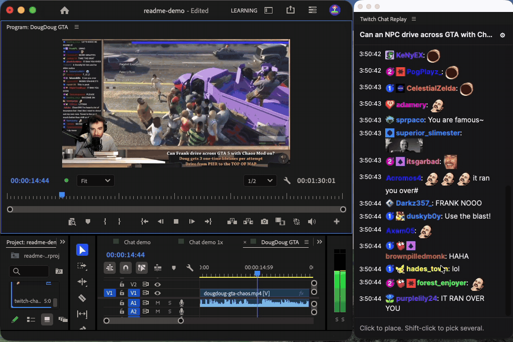

# Twitch Chat Replay

A Premiere Pro plugin to easily create twitch chat screenshots from a chat that syncs to your VOD recording.

## Install

1. Download the `.ccx` file from [the latest release](../../releases/latest).
2. Double-click it. Creative Cloud installs the plugin.
3. In Premiere Pro 26.5 or newer, open **Window > UXP Plugins > Twitch Chat Replay**.

## Use

1. Paste the Twitch VOD link and pick the footage of the stream from the active sequence.
2. Drag the slider to sync the preview to your footage, then click **In sync**.
3. Move the playhead. The chat follows it.
4. Click a message to place it on the timeline. Shift-click to pick multiple and generate a video.

The first time you place a message, the plugin asks for a folder to save the rendered clips in.

Chat comes from Twitch's unofficial API so open an issue if it breaks.
